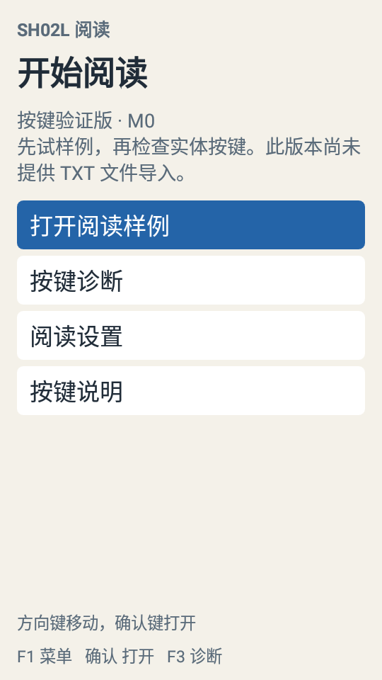
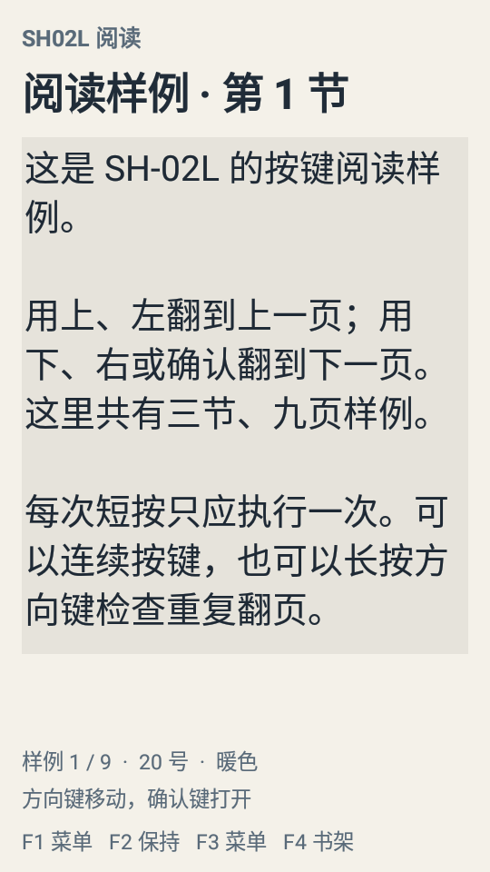

# M0 按键与焦点原型验证

日期：2026-10-18（Asia/Shanghai）。
版本：`0.1.0-m0`，正式应用 ID：`com.sh02l.reader`。
当前进度：M0 完成。用户在 SH-02L 上完成指定实体按键序列并反馈“已按完，表现正常”，后续进入 M1。

## 已交付功能

- 原生 Android 工程：`app` 与可独立测试的 `reader-core`。
- 按键标准化、UNKNOWN scanCode 兜底、完整按键周期消费、上下文归属与可控重复。
- 单 Activity 覆盖层菜单、真实控件焦点、返回后恢复原条目，以及退出确认层。
- 三节九段阅读样例、目录、样例书签、字号、主题、应用亮度和信息栏。
- 大字号样例分屏浏览，菜单关闭后恢复滚动位置。
- 256 条有界事件记录、应用内保存、后台原子写入、合盖/后台清除保持按键。
- 独立签名、构建脚本、依赖校验、原生测试脚本和本地发布脚本。

真实 TXT 文件导入、编码识别、正文分页、持久化书籍进度尚属 M1 及以后。M0 样例段号不作为未来真实图书的永久定位。

## 构建与验证结果

| 项目 | 环境 | 结果 |
| --- | --- | --- |
| 按键周期与导航 JVM 测试 | JDK 17 | 24 项通过，0 失败、0 错误 |
| 原生界面测试 | API 27 x86 模拟器，540×960 / 240 dpi | 6 项通过 |
| 原生界面测试 | SH-02L，Android 8.1.0 / API 27 | 6 项通过 |
| debug / test APK 构建 | AGP 8.6.1 / Gradle 8.7 | 通过 |
| release 构建、R8、资源裁剪 | 同上 | 通过 |
| Android Lint | debug / release | 0 错误，6 项警告 |
| APK 签名 | API 27 校验 | APK Signature Scheme v2 通过 |
| APK 对齐 | zipalign，4 字节 | 通过 |
| 正式签名包冷启动 | SH-02L | 20 / 20 成功 |
| 实体方向键、确认、F 键与长按 | SH-02L，用户手测 | 用户反馈正常 |

原生界面测试覆盖实际焦点、首次菜单与返回、嵌套退出确认的 F2、模拟 UNKNOWN/F2 扫描码、阅读区域尺寸/全屏标志、大字号滚动恢复，以及连续 20 次菜单开关。系统注入和代码构造事件的结果与实体按键手测分别记录。

JVM 测试另覆盖短按不重复、快速两次短按、按住确认不跨界面翻页、孤立 repeat、失焦后的旧长按、不同设备的事件、旧抬起事件、1000 次菜单回环、设置边界、损坏状态恢复和诊断缓冲区上限。

第一轮真机原生测试曾因屏幕关闭而没有收到注入按键，测试代码继而访问不存在的阅读控件。唤醒并确认屏幕可交互后，同一应用构建的 6 项测试全部通过；测试脚本现包含唤醒与前置状态检查。该记录不计入正式应用冷启动崩溃。

Lint 警告为固定竖屏相关 2 项、Android 12+ 数据提取规则 1 项、文本国际化格式 3 项；本版本专门面向 SH-02L/API 27 的中文界面。后续扩展系统和语言支持时逐项处理。

## 正式包与性能基线

- APK：23,988 字节（约 23.4 KiB）。
- SHA-256：`a0c632061a888643a0a1ed729c9d0b9fb53ade3848fedf253077e8840d4d9ce9`。
- 设备：SH-02L，Android 8.1.0，540×960，240 dpi，`armeabi-v7a, armeabi`。
- `am start -W` 的 20 次冷启动：中位数 607 ms，P95 644 ms，最大值 677 ms。
- 一次样例阅读稳态总 PSS 快照：21,037 KiB，约 20.5 MiB。

这些数值属于 M0 原型和样例场景。真实书库、10/50 MiB TXT、索引、分页和长时间阅读的正式性能目标仍需在 M1—M3 验证。

## 原始证据

本地原始记录位于被 Git 忽略的 `tools/logs/`：

- `verify-final-m0.log`、`release-m0.log`：构建记录。
- `instrumentation-api27-emulator.txt`、`instrumentation-sh02l.txt`：原生测试结果。
- `coldstart-sh02l.json`、`meminfo-sh02l.txt`：启动与内存快照。
- `physical-keys-sh02l.txt`：实体按键采集快照。

实体测试序列为 ↑、↓、←、→、确认、F1→F2、F3→F2、长按 ↓ 约 1–2 秒、F4。用户反馈表现正常。留存日志包含 173 条实体事件且全部被应用消费，直接观察到方向/确认、F1/F2/F4 和多组数字键的按下、抬起及方向键重复；快照未留存左键与 F3 的对应记录，因此这两键的本轮结论来自用户观察，不能将其描述为原始日志已完整采集。UNKNOWN/F2 兜底由自动测试覆盖。

JVM XML 报告位于 `reader-core/build/test-results/test/`，Lint 报告位于 `app/build/reports/`。发布目录的 `build-info.json` 记录 APK 对应来源提交。

## 真机界面

