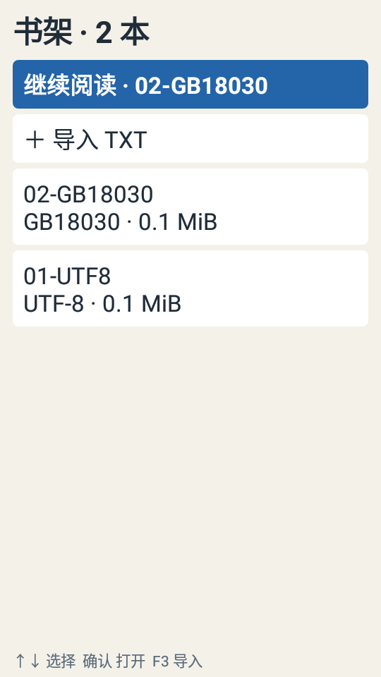
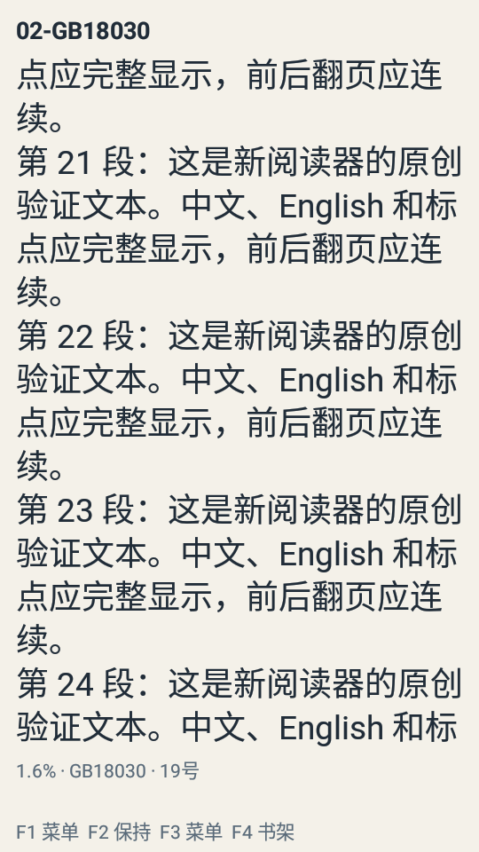

# M1 TXT 核心流程验证

日期：2026-10-18（Asia/Shanghai）。版本：`0.2.0-m1`，应用 ID：`com.sh02l.reader`。

本阶段将 M0 样例替换为真实本地 TXT 阅读，提供书架、导入、编码识别、有界分页和持久化阅读位置。目录与基础书签已经接入真实正文。M1 是阶段交付，完整 TXT 稳定版仍需完成 M2/M3 的功能与长期回归。

## 功能与实现

- 单窗口原生界面和统一按键周期；确认键在正文中只执行一次，方向键允许受控长按。
- 虚拟化书架、文件和目录列表；F3 导入，按键可浏览应用导入文件夹，另有共享存储和系统文件选择入口。
- 保留原始字节，SHA-256 去重、私有书库、流式解码、LF 归一化、有界章节识别与索引。
- BOM / 严格 UTF-8 / GB18030 编码路径，包含 UTF-16LE/BE BOM 与 GBK 兼容内容。
- 独立 `engine-txt` 模块、Android `StaticLayout` 排版、无动画分页、三个窗口缓存。
- TXT v1 正文偏移定位；改字号、信息栏或主题后重排，菜单本身不改变阅读区域。
- SQLite 书架、进度和书签；后台串行提交进度，过时显示任务不能覆盖当前图书。
- 复制/导入可取消，失败清理临时文件；保留独立签名与 M0 的真实显示设置。

数据格式与具体故障边界见 [TXT_STORAGE.md](TXT_STORAGE.md)。

## 自动验证

| 验证 | 环境 | 结果 |
| --- | --- | --- |
| JVM 按键、导航与 TXT 测试 | JDK 17 | 33 项通过，0 失败、0 错误 |
| 原生界面与引擎测试 | API 27 x86 模拟器，540×960 / 240 dpi | 12 项通过 |
| 原生界面与引擎测试 | SH-02L / Android 8.1.0 / API 27 | 12 项通过 |
| debug / test / release 构建 | AGP 8.6.1 / Gradle 8.7 | 通过 |
| Android Lint | debug / release | 0 错误，6 项警告 |

JVM 文本测试覆盖四种编码、原始字节不变、BOM、跨读取块 CRLF、UTF-8 后段才出现非法字节、空文本、损坏 UTF-16、二进制 NUL、取消、临时目录失败时关闭源文件、代理对/组合字符边界，以及三百万字符无换行文本。

原生界面测试覆盖列表真实焦点、首次菜单、UNKNOWN/F2、相同阅读 View 和尺寸、前后翻页、重排包含原锚点、正常返回重开、20 次菜单回环、取消后再次导入、快速改字号并切书、改字号后跳书签。

排版测试把包含中英文、标点、emoji、扩展汉字、组合字符、空行和 CRLF 的文本归一化为 25,271 个 UTF-16 单元。20/32/48 px 三种字号分别遍历 115/231/414 页，合计 760 页：每页逻辑范围连续无重叠，逐页拼接等于完整预期正文，反向翻页返回相同范围。

另在两个 API 27 环境中实际导入并排版 1 MiB、10 MiB GB18030 文件，以及 50 MiB UTF-8 无换行文件。验证 GB18030 扩展汉字、开头/中部/末尾定位、50 MiB 原始副本完整大小和布局窗口上限，没有 OOM。

## 正式签名包验证

正式包通过应用文件列表，以方向键和确认键导入两份原创 UTF-8 / GB18030 验证读本。各翻页后保存已提交位置，返回前台阅读再强制停止进程，重开比较书籍 ID 与正文偏移；模拟器和 SH-02L 分别保留原始记录。

强杀测试保证的是最后已提交位置。未提交窗口内的断电、任意瞬间存储故障、真实来电和长期合盖回收仍需 M2/M3 专项验证，不能用这次测试替代。

覆盖安装沿用独立签名，测试读本和进度继续可读取。重复导入使用相同 ID 并保留进度。正式 APK 约 40 KiB，精确字节数、SHA-256、签名与来源提交以发布目录 `build-info.json` / `SHA256SUMS.txt` 为准。

真实屏幕截图另行核对；SH-02L 的无障碍界面树曾将底部区域报告为裁切，截图确认信息栏和软键提示实际完整可见，因此没有据此加入屏幕像素补丁。

## 实体按键与合盖手测

正式包在 SH-02L 打开真实 TXT 后，用户完成前后翻页、菜单、按住并松开方向键、合盖展开、返回书架与恢复的手测，反馈：“翻页、菜单和恢复都正常”。

当前进程留存 46 条实体事件，全部被应用消费。日志直接观察到 ↑、↓、确认及 F1—F4 的 Down/Up，抬起只释放、不再次执行动作；本轮 F3 的 code=133 / scan=754 已直接采到。本轮方向键按住约 741 ms，快照未出现 repeat>0，因此不把它当作持续 Repeat 压力测试；M3 仍需专测更长按住、跨窗口加载及松开后的队列状态。

原始快照为 `tools/logs/physical-keys-m1-sh02l.txt`。合盖与恢复的可见结果来自用户观察，和自动恢复测试分别记载。

## 内存与耗时边界

12 项原生测试的一轮 SH-02L 快照：1 MiB GB18030 为 26,838 KiB PSS，10 MiB 为 27,256 KiB；50 MiB UTF-8 为 28,100 KiB。50 MiB 案例的文件生成、导入与抽样排版合计约 19.0 秒。测试进程包含原生测试代码，这些是特定时间点快照，不能当作峰值、正式阅读稳态或 P95。

本阶段证明读取和排版没有随整本内容装入内存。100 本书启动、300 次翻页延迟、正式包 10/50 MiB 稳态和两小时阅读仍由 M3 的性能清单定义。

## 本地证据

原始日志位于 Git 忽略的 `tools/logs/`：

- `verify-m1-delivery.log`、`release-m1-delivery.log`：构建。
- `instrumentation-m1-delivery-emulator.txt`、`instrumentation-m1-delivery-sh02l.txt`：12 项原生测试。
- `metrics-m1-emulator.txt`、`metrics-m1-sh02l.txt`：分页与文件规模快照。
- `release-smoke-m1-emulator.json`、`release-smoke-m1-sh02l.json`：正式包导入与前台强杀恢复。
- `snapshot-m1-*.txt`：界面位置与最后提交位置。

JVM XML 位于 `reader-core/build/test-results/test/`；Lint 报告位于 `app/build/reports/`。发布目录附该报告、变更说明、APK 校验值和来源记录。

## 尚待完成

M2：正文搜索与输入、进度跳转、手动纠正编码、行距/边距/字体、书籍和书签管理、损坏缓存重建；共享存储权限弹窗、内存卡和系统输入法需要逐项实测。M3：完整按键与异常回归、长期阅读、升级数据与性能验收。EPUB 按原计划在 TXT 稳定后加入。

固定文本窗口末尾可能出现不足一屏的页面；正文连续性已验证。当前未声称任意编码、复杂双向排版或所有异常字素都已完整支持。
