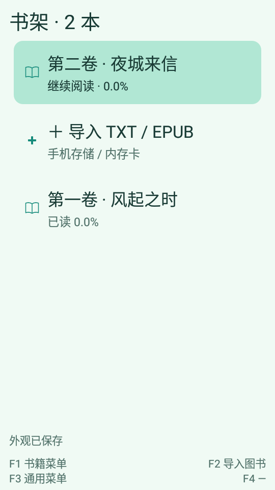
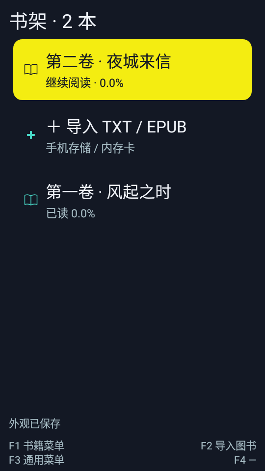
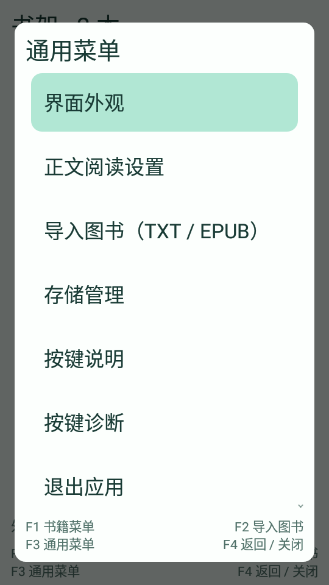
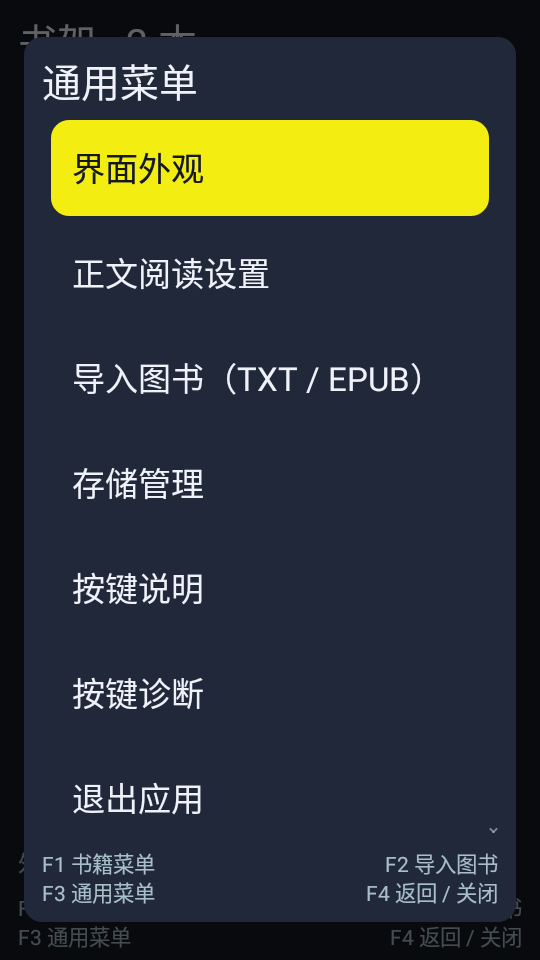

# M4.3 主题修订验证

基线：M4.2 / `76802a2`。设备：SH-02L / Android 8.1 / 540 × 960；修补版本 `0.6.3-m4.3` / code 12。自动测试使用独立 debug/test 包和自有文本夹具。

## 定点检查

- `build.ps1 -Task verify` 通过：核心 61 项、EPUB 10 项 JVM 测试通过，debug lint 为 0 errors / 18 warnings。
- 新增 3 项核心检查：亮色焦点使用深色字；原本清晰的配色保留；低对比度自定义色可回退到清晰字色。计算不依赖 Android，不分配临时通道数组。
- 7 项真机检查通过：旧预设迁移、任何手动改色保留、封面与图标焦点切换、两套预设的实体键切换/保存/菜单和书架对比度、异步封面复用，以及已有外观草稿保存/放弃和图片预览/保存。
- 仅对完整匹配旧七色数组的预设迁移，往返保存再次解析保持一致；背景路径、样式、缩放、位置及遮罩均核对保留。定制任意一个颜色值后不迁移。
- 两套主题的书架标题/进度、菜单选中项文字对比度检查 ≥ 4.5，小图标 ≥ 3；实际封面不应用 tint。这里测试的是静态纯色区域，用户自定义图片本身的可读性仍取决于遮罩与选图。
- 首次截图含系统导入提示，待提示消失后重新执行一次主题操作并截图；没有因此扩大测试范围。

## 真机截图

以下为独立调试包的原始 540 × 960 截图，使用自有两本文本夹具。它们展示实际原生界面，不是设计效果图。已检查对称边距、选中态、书籍小图标、菜单和底部提示；长期审美与屏幕舒适度继续按试用反馈调整。

| 初音未来 | 边缘行者 |
| --- | --- |
|  |  |
|  |  |

## 性能与范围

颜色是少量整型常量；焦点颜色在构造 Palette 时派生，绘制和行绑定读取已有结果。没有新增图片解码、动画、线程、网络请求、磁盘缓存、常亮或后台任务。参考图仅用于开发时配色分析，不随应用分发。未修改阅读引擎、图书解析和存储结构，本轮不重复大型 EPUB 性能基准或长时压力测试，也不声称测得新的续航提升。

## 正式覆盖升级

- release 构建通过，lint 为 0 errors / 18 warnings；正式签名与 M4.2 相同，zipalign 通过。
- 源码提交 `014e803`。APK 为 139,956 字节，比 M4.2 增加 340 字节；SHA-256：`d18a2b1950537a8e4b140fa392218eb5710ccaa36a7cd9d8f2543f4248a17a7b`。
- 升级前发现正式应用停在「霓虹夜色」外观草稿页，询问后按用户明确选择放弃草稿，以实际已保存的「白色」外观取得新基线。
- 使用相同签名 `adb install -r` 升级到 code 12，未卸载或清空正式应用。升级前后书架均 3 本，进度为 2.8%、0.3%、0.3%；当前 TXT 的显示和提交定位均为 `txt-v1:234973`。
- 正文无障碍内容 SHA-256 前后一致：`24a42b7c8ee0b810e3a258adcd14fc4fb76071a7083e0950d13a83a55e55aa06`。
- 阅读白色、17 号、亮度 70%、信息栏显示、行距 4 dp、左右 12 / 上下 10 dp 保持。界面白色、独立封面、铺满/居中/中遮罩保持；没有替用户切换到新主题。
- 正式包不支持 run-as，核对范围是可观察的上述状态，没有宣称逐字节检查完整数据库或所有书签。

- 正式包菜单、帮助、前后台恢复和强制停止后的重开检查通过；定位仍为 `txt-v1:234973`，未导入任何正式测试图书，结束时回到书架。

## 清理与交付

本轮 debug/test 包均已卸载，设备上仅保留正式 `com.sh02l.reader`，两个调试包的外部目录确认不存在。删除 9 个本轮 `/data/local/tmp/m43-*.xml` 和正式诊断目录中的临时 UI XML；没有删除正式原件、设置或进度。

工作区删除 16 个本轮参考原图与中间 UI/诊断文件，共 2,643,422 字节，保留精简的升级前后摘要、测试结果、4 张真机截图和交付记录。此前 M4 清理被自动审批阻止的旧目录没有重试处理，不计入本轮清理。

本地整合交付目录 `dist/v0.6.3-m4.3/`。原始验证日志位于忽略的 `tools/logs/m43/`、`instrumentation-m43-*.txt` 和 `release-smoke-m25-m43.json`。

2026-11-08 后续按用户要求，将 M4–M4.3 的 8 个提交快进合入并推送到 `main`，发布标签 `v0.6.3-m4.3` 指向 `d98b506`。[GitHub 试用预发布](https://github.com/hirasawamugi/SH02LReader/releases/tag/v0.6.3-m4.3)包含 APK、`SHA256SUMS.txt` 和 `build-info.json`，三个公开下载附件的 SHA-256 均与本地产物一致。发布沿用已验证 APK，没有重建应用或重复运行设备测试；之后的下载入口文档更新不改变编译来源。
