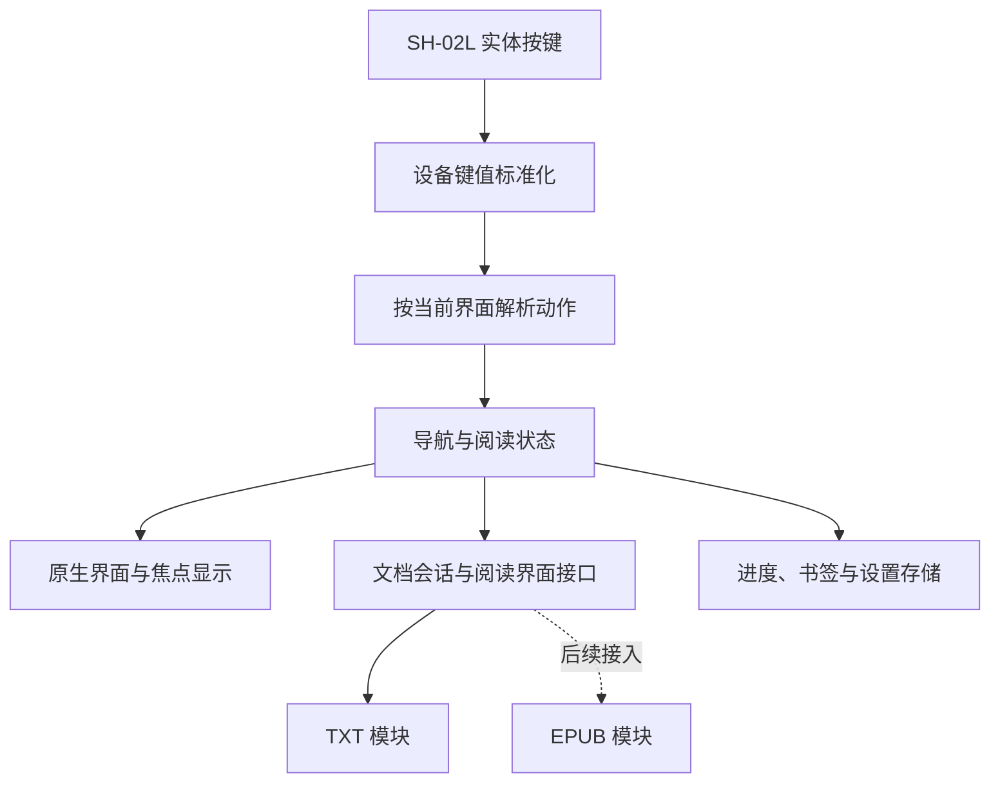

# SH-02L 阅读器实施计划

日期：2026-10-18（Asia/Shanghai）
状态：M0/M1/M1.5 已交付；M2 日常阅读与存储管理已实现并完成关键代码/原生回归，正式候选与升级记录见 `M2_VALIDATION.md`。用户于 2026-10-19 授权适当减少重复测试，保留数据安全和输入/定位检查；M3 长期试读与性能验收、M4 EPUB 仍按下述阶段继续。当前执行范围与结构见 `HANDOFF.md`、`superpowers/specs/2026-10-19-m2-daily-reading-design.md` 和 `superpowers/plans/2026-10-19-m2-daily-reading.md`。
开发负责人：Codex，负责源码实现、构建、测试、问题定位和 APK 交付。
已确认范围：先完成稳定的本地 TXT 阅读，随后加入 EPUB。

目录约定（2026-10-18 隔离更新）：新工程根目录为工作区下的 `SH02LReader/`；除明确标注外，本文路径均相对此新工程根目录。旧 APK 适配工程位于相邻的 `../AAReader/`。

## 1. 产品与技术决定

建设一个面向 SH-02L 的 Android 原生源码工程：Java + 原生 Views、统一按键和导航状态、独立 TXT 阅读模块、可替换的文档与阅读界面接口。第一阶段交付可日常使用的离线 TXT 阅读器，后续通过新模块接入 EPUB。

优先级：按键正确性和阅读数据可靠性 > 响应和内存 > 日常功能完整性 > 动效与装饰。

SH-02L 的官方规格为 3.4 英寸、540×960 TFT、1 GB RAM、MSM8909 1.1 GHz；Android 8.1 和特殊按键信息以本项目设备记录为依据。按小屏实体键设备设计，并使用设备实际密度换算尺寸。[官方硬件规格](https://www.docomo.ne.jp/support/product/sh02l/spec.html)

本计划适用于新的源码工程。原有 APK、历史版本、签名材料和构建工具整体保留在旧工程 `../AAReader/`。新源码工程直接以 `SH02LReader/` 为根，使用独立应用 ID（暂定 `com.sh02l.reader`），可与旧版并存；旧版书架数据库的直接迁移另行评估。

## 2. 开源项目如何用于实现

以下是调研快照，SHA 用于后续追溯参考代码。M0 参考其设计并新增实现，尚未移植这些项目的源文件或引擎；来源说明见新工程根目录的 `NOTICE.md`。

| 参考项目 | 调研提交 | 用于本项目的部分 | 实施边界 |
| --- | --- | --- | --- |
| CoolReader | `dcc2d4c88b7ee66b8ee1223833c1a72cad3cdbc5` | 按键与阅读动作分离、可重复动作标记、阅读设置与文档位置的组织方式 | TXT 首版采用平台文本排版；CoolReader 的原生引擎作为后续复杂格式的候选方案 |
| KOReader | `9616cf3c6136595984efad8ead5bc2ed995e715b` | 设备配置与通用交互分离、按键映射、按键菜单导航 | 使用它的设备适配思路；Android 应用事件分发由新工程实现 |
| NovelReader | `0b8e281b30beecbc1b91d1deeca30301a88b6f5c` | TXT 分章、章节索引、本地加载、分页职责划分 | 编码解码、跨块边界和缓存逻辑重新实现并覆盖边界测试；旧依赖不直接引入 |
| Readium Kotlin Toolkit | `89b96c20c447d0aec17db57a06456b7decffde4c`（develop 调研快照） | EPUB 文档模型、定位与阅读组件 | M4 选择正式版本做 SH-02L 验证；其 WebView 或阅读组件不进入 TXT 首版依赖 |

参考入口：

- [CoolReader ReaderAction](https://github.com/buggins/coolreader/blob/dcc2d4c88b7ee66b8ee1223833c1a72cad3cdbc5/android/src/org/coolreader/crengine/ReaderAction.java)
- [KOReader Android 设备适配](https://github.com/koreader/koreader/blob/9616cf3c6136595984efad8ead5bc2ed995e715b/frontend/device/android/device.lua)；[Android 按键映射说明](https://github.com/koreader/koreader/wiki/Android-tips-and-tricks#customize-keys)
- [NovelReader 本地加载模块](https://github.com/newbiechen1024/NovelReader/blob/0b8e281b30beecbc1b91d1deeca30301a88b6f5c/app/src/main/java/com/example/newbiechen/ireader/widget/page/LocalPageLoader.java)
- [Readium 正式版与系统要求](https://github.com/readium/kotlin-toolkit/releases)

引用实际代码时记录仓库、提交、文件和适用许可，并生成第三方声明。只参考设计和直接复制代码分别记录；工程最终许可按实际集成内容确定。上游主许可证分别为 CoolReader GPL-2.0-or-later、KOReader AGPL-3.0、NovelReader MIT、Readium BSD-3-Clause。

## 3. 架构与扩展方式

首版只建立必要的 Gradle 模块：

| 模块 | 职责 | 边界 |
| --- | --- | --- |
| `:reader-core` | 动作、导航状态、文档标识、定位和能力接口 | 主要逻辑不依赖 Android UI，可做 JVM 单元测试 |
| `:engine-txt` | 流式解码、章节索引、布局、页面缓存、TXT 阅读界面适配器 | 使用 Android `StaticLayout` 等平台组件处理文本排版 |
| `:app` | SH-02L 设备配置、界面、按键入口、文件导入、SQLite、设置与发布 | 用包隔离设备、界面和数据职责；有实际需要时再拆模块 |
| `:engine-epub` | 后续 EPUB 文档与阅读界面适配器 | M4 加入，保持共用按键、书架和书签入口 |

接口分为两层：

1. 文档会话：元数据、章节、定位、搜索和内容访问。
2. 阅读界面适配器：显示定位、翻页、应用样式、上报实际显示位置与就绪状态。

TXT 的 Canvas 排版和 EPUB 的 WebView/原生引擎渲染各自实现阅读界面适配器。共用动作与存储协议，并允许格式保留自己的定位结构。EPUB 的接入仍需实现和验证专用界面适配器。

扩展采用编译时模块和能力声明。例如字号、全文搜索、选词和朗读通过能力标记控制菜单可用性；某格式不具备的能力不展示为可执行项。首版保持静态模块结构。

## 4. 按键与焦点规则

### 4.1 唯一键值依据

`device/sh02l按键值.txt` 是本新工程 SH-02L 配置的唯一依据。它是从旧工程复制并校验一致的独立资料副本。F1—F4 的 keyCode 为 131—134、scanCode 为 752—755。M0 补充记录 ACTION_DOWN、ACTION_UP、repeatCount、downTime、设备标识及系统是否实际把事件交给应用。

标准 keyCode 优先；只有 keyCode 为 UNKNOWN 等已证实异常情况，才用配置中明确记录的 scanCode 兜底。未识别的键保留诊断记录，避免猜测映射。

### 4.2 事件处理

- 所有应用内页面进入同一套标准化和动作解析逻辑，菜单优先于被覆盖的阅读页。
- 每个物理按键周期记录事件归属；一次短按只执行一次动作，ACTION_UP 负责结束周期并被正确消费。
- 打开或关闭菜单后，同次按键的剩余事件仍归属于原按键周期，防止抬起事件误作用于新页面。
- 连续翻页、列表移动、字号和亮度调节可以重复；打开菜单、返回、添加书签等动作默认不重复。
- 依据事件周期和 repeatCount 处理重复，避免用全局防抖误吞两次正常短按。
- 失去窗口焦点、合盖、进入后台时清除按键保持状态，恢复后不继续执行旧的长按。

### 4.3 全部功能可用短按完成

书架、文件浏览、目录、设置和应用内菜单使用明确的导航关系。每个页面只维护一份当前区域、条目 ID 和滚动锚点；视觉高亮由这份状态和控件实际选择状态共同驱动，避免出现只画蓝框却没有有效选择的情况。

菜单在同一个 Activity 的应用内覆盖层显示，返回时恢复原条目和滚动位置。系统权限弹窗属于独立窗口，单列为真机验收项目。方向导航关系和必要的 `nextFocus*` 属性明确设置。[Android 方向导航文档](https://developer.android.com/develop/ui/views/touch-and-input/keyboard-input/navigation)

挂断键、清除键按现有记录保留系统行为，不作为应用内导航的唯一入口。对应用实际收到的已分配 F 键等事件完整消费，并验证不会触发相机、邮件或浏览器；系统保留键的行为通过真机记录确认。

### 4.4 默认按键表

| 按键 | 列表、目录、设置 | 阅读正文 | 菜单或应用内弹层 |
| --- | --- | --- | --- |
| 上 / 下 | 上一项 / 下一项 | 上一页 / 下一页 | 上一项 / 下一项 |
| 左 / 右 | 页面明确标示的分页或数值调整 | 上一页 / 下一页 | 数值调整；无数值时不跳出当前层 |
| 确认 | 打开或执行当前项 | 下一页 | 执行当前项 |
| F1 | 当前页面菜单 | 阅读菜单 | 保持当前菜单，不重复叠加 |
| F2 | 返回上一层；书架根层保持 | 无菜单时保持正文 | 关闭最上层，恢复原焦点 |
| F3 | 书架导入；其他页面按软键提示 | 阅读菜单 | 仅执行明确标示的页面动作 |
| F4 | 返回上一层；书架根层保持 | 返回书架 | 先关闭当前层 |
| 1 / 3 | 仅在页面明确标示时作为快捷键 | 上一章 / 下一章 | 遵循弹层自己的映射 |
| 2 | 同上 | 目录 | 同上 |
| 4 / 6 | 同上 | 减小 / 增大字号 | 同上 |
| 5 | 同上 | 切换阅读主题 | 同上 |
| 7 / 9 | 同上 | 降低 / 提高应用窗口亮度 | 同上 |
| 8 | 同上 | 显示 / 隐藏阅读信息栏 | 同上 |
| 0 | 按键帮助 | 按键帮助 | 弹层有输入需求时按输入规则处理 |
| 星号 | 页面定义的快捷入口 | 阅读设置 | 遵循当前层规则 |
| 井号 | 页面定义的快捷入口 | 书签菜单，含添加当前书签和书签列表 | 遵循当前层规则 |

各页面底部只显示当前可执行的软键提示。文本输入页面让数字键进入文字输入模式，数字阅读快捷键在该模式下暂停。退出应用由根菜单提供明确入口。

## 5. 小屏界面

- 首页采用单列书籍列表，提供继续阅读、全部书籍和导入入口；书籍管理通过菜单完成。优先减少跨区域焦点切换。
- 当前项同时使用高对比底色、文字色和位置标记；屏幕上始终可辨认当前操作对象。
- 目录、书签、设置沿用同一种列表导航和返回规则；所有必需功能有可聚焦入口。
- 内容高度按屏幕可用空间、系统密度和字号计算，不硬编码固定像素或固定行数。
- 正文默认无翻页动画，使用系统字体，提供浅色、暖色和深色主题。自定义字体通过文件导入，并提供系统字体回退。
- 全屏与状态栏策略由窗口控制器统一管理。菜单显示不改变阅读区域；信息栏显隐会触发布局更新并保持正文锚点。
- 空书架直接显示可执行的导入项；空目录、空书签和读到末尾都有明确状态及返回入口。

2026-10-18 新增 M1.5：在保留 TXT 阅读、数据与既有按键功能的基础上，按用户要求增加 0 键帮助开关，并统一全软件的颜色、文字层级、间距、焦点高亮、图标和软键提示。采用已确认的“清爽纸感”基调和米白、墨灰、雾蓝配色；浅色、暖色、深色模式继续保留。主题与共用控件样式集中维护，M2 及后续页面沿用同一套规范，新增入口需验证与既有主题和按键规则相容。

后续问答已确定：界面/正文配色独立、5 键保留正文切换、柔白/米白/暖炭灰、浅灰蓝底与蓝色侧标、舒适均衡、正文软键常显、分层设置和即时保存；书架可选纯文字/小书标/单列封面，默认小书标，封面可复制/移动导入并居中裁剪，缺失时用统一默认封面。完整细节、首版尺寸、导入依赖及帮助页对齐要求见设计基线和实现计划；按键图的旧样稿不能直接作为对齐验收依据。

## 6. TXT 阅读实现与数据可靠性

### 6.1 导入和编码

- 支持应用内按键文件浏览、从文件打开和内存卡来源。Android 8.1 的权限申请与系统文件选择分别实测。
- M1 补充验收：2026-10-18 用户确认 SH-02L 内存卡导入和系统文件选择正常，记为真机手测通过；权限拒绝/撤销等异常流程仍单独验证。
- 默认导入到应用私有书库，保留原始文件字节，原文件不被改写；导入前检查空间，可取消并显示进度。
- 导入文件、索引和数据库采用临时文件与事务提交。取消、断电或失败时清理未完成状态，已存在图书保持可用。
- 已确认提供复制导入和移动导入，最新 M1.5 计划让 TXT/封面共用该流程：复制保留来源，移动仅在完整导入、校验与持久提交成功且具备删除能力后删除来源。两种模式均需覆盖已知/未知来源大小的峰值空间预算、导入过程中的可用空间检查和安全余量；触及保护线时停止大写入并清理本次未提交文件，移动来源保持不变。完整低存储进度保护仍在 M2。
- 编码识别按 BOM、严格 UTF-8 验证、候选编码预览处理；支持 UTF-8、带 BOM 的 UTF-16LE/BE 和 GB18030/GBK，提供手动纠正入口。ASCII 等存在歧义时保留编码选择能力。
- 使用流式解码器保留跨块多字节字符、代理对和跨块换行状态。索引、正文位置和缓存使用统一的归一化规则；规则变化时使旧缓存失效。

### 6.2 排版与加载

- 正文使用 `StaticLayout` 等系统文本排版能力，覆盖中文、英文、标点、段落和替代字体。[StaticLayout 文档](https://developer.android.com/reference/android/text/StaticLayout)
- 按有界文本窗口和章节读取内容，缓存当前页与少量相邻页；不在启动时一次排完整本书。
- 首次章节索引在后台建立并持久化；重开复用有效索引。超长无换行段落也必须按有界窗口处理。
- 解码、索引、搜索、导入和磁盘写入离开主线程。显示状态在主线程串行更新。
- 每次打开图书、改变布局或切换章节更新任务代号；旧任务返回时检查代号，避免旧内容覆盖新页面。
- 队列设置上限，预取任务可以取消。连续翻页时优先完成当前用户请求，取消失效预取。

### 6.3 进度与恢复

- 永久进度保存书籍 ID、格式化的正文定位、上下文锚点及定位版本；页码作为当前布局的派生显示。
- TXT 使用归一化文本位置。EPUB 使用自己的文档片段定位，两者由统一的定位容器承载。
- 字号、行距、字体、边距或信息栏变化时，以原位置重新排版，原文仍出现在当前页附近。
- 翻页后串行提交最新位置，合并尚未开始的旧写入；正常离开、合盖和进入后台时优先提交最新进度。
- 强杀或断电只能保证恢复最后成功提交的位置。验收分别记录正常退出恢复和异常中断恢复，不能把生命周期回调当成异常退出时的必然事件。
- 数据库采用版本化迁移与事务；设置小文件使用原子写入。升级前验证旧书架、书签和进度可继续读取。
- 已导入图书可在移除原内存卡后继续阅读；书库空间不足、缓存损坏和文件缺失均有可恢复操作。

M2 书架改为带排序索引的分批元数据查询，只保留当前及少量相邻批次；最近阅读与总数独立查询，返回按书籍 ID 和滚动锚点定位，避免全库对象常驻或每次打开书架遍历所有书籍文件。数据查询、空间统计和旧任务失效均沿用后台执行与任务代号约定。

M2 低存储处理需优先保护进度：预先实际分配小型应急文件，空间不足时停止导入/缓存重建，释放应急空间并有限重试最新位置；失败的进度保留待重试，并持续区分“待保存”与“已提交”。提供书库占用和大文件管理入口；派生缓存只有在原始副本完整、重建路径可用后才允许回收，保留当前阅读图书。具体方案和 M1 源码缺口见 `HANDOFF.md`。彻底不可写时不能保证新进度落盘，需保留最后完整提交记录并明确提示。

## 7. 首版范围与后续功能

TXT 稳定版包含：本地导入与管理、最近阅读、完整按键导航、前后翻页、自动分章与目录、进度跳转、书签、字号/行距/边距/主题/亮度、编码纠正、正文搜索、进度与设置保存、合盖恢复、按键帮助和诊断信息导出。

搜索与进度输入采用原生输入框及可按键操作的确认、取消按钮。手动进度跳转可直接用数字输入；中文搜索先验证 SH-02L 自带输入法。系统输入法若有设备限制，记录具体能力与替代入口后处理，不把未通过的功能列为已完成。

EPUB、朗读、额外格式和同步按独立模块安排。TXT 首版只申请本地阅读需要的权限，不引入网络书源、常驻后台服务、大型字体包或持续刷新动画。

## 8. 轻量与性能预算

下表是完整 TXT 稳定版需要在 SH-02L 上验证的工程目标。M0/M1 已有阶段快照，见对应验证报告；尚不能替代这些完整条件下的性能验收。

| 项目 | 初始目标 | 测量条件 |
| --- | --- | --- |
| TXT 正式 APK | ≤ 5 MiB | 签名 release 包，含首版完整功能，不含导入书籍和用户字体 |
| 稳态阅读内存 | 总 PSS ≤ 80 MiB | 10 MiB TXT、索引完成后；同时观察 50 MiB 文件，避免随文件大小等比增长 |
| 冷启动到可操作书架 | P95 ≤ 2.5 秒 | 真机、已导入 100 本书、首次安装初始化和首次导入单列 |
| 列表按键到正确高亮 | P95 ≤ 100 毫秒 | 至少 100 次正常短按，记录实际绘制 |
| 已就绪页面翻页 | P95 ≤ 100 毫秒 | 至少 300 次翻页；跨章节未缓存页面单独统计 |
| 耗时任务 | 主界面可操作，可取消 | 导入、索引和搜索期间能打开菜单、返回或取消 |
| 静置与后台 | 无无意义持续渲染和常驻任务 | 后台释放预取；时钟等只在需要显示时低频更新 |

性能达不到目标时先分析读取、布局、缓存或重绘原因，记录调整依据。不能以漏字、错页、丢进度换取测试数字。EPUB 接入时新增独立的包体、内存和 WebView/原生引擎测试预算。

## 9. 阶段交付与完成条件

| 阶段 | 我交付的内容 | 进入下一阶段的条件 |
| --- | --- | --- |
| M0：构建与按键验证 | 独立源码工程、可安装诊断 APK、键值记录、列表与覆盖层菜单原型、构建说明 | SH-02L 冷启动；记录 Down/Up/Repeat；F1—F4、方向键和确认操作正确；菜单关闭后恢复焦点 |
| M1：TXT 核心流程 | 导入、编码、列表书架、无动画分页、位置保存与恢复 APK | UTF-8/GB18030 测试书可完整阅读；页边界无丢字重复；正常退出和强杀后按定义恢复位置；50 MiB 文件不 OOM |
| M1.5：主题与界面基础 | 全局视觉规范、共用主题与控件样式、经确认的外观功能、现有页面适配 APK | 主题基调、核心样稿和外观新增项经确认；浅/暖/深色模式统一；真机文字、焦点与软键清晰；原有功能和用户数据回归通过；后续页面可沿用共用样式 |
| M2：日常功能 | 目录、章节跳转、书签、排版设置、搜索、按键帮助、内存卡导入、异常提示 APK | 全部入口用按键可达；改排版保持正文锚点；取消任务和快速切换书籍不会串页；所有关键流程可完成 |
| M3：TXT 稳定版 | 签名正式 APK、完整源码、回归和性能报告、已知限制与升级说明 | `SH02L_ACCEPTANCE.md` 的关键项全部通过；Codex 完成工程回归与升级数据验证，用户完成长时间日常试读 |
| M4：EPUB 增量版 | EPUB 引擎适配原型、按键适配、格式定位和新增测试，验证后交付正式增量版 | 使用真实设备的 WebView/ABI 条件评估 Readium 与 CoolReader；共用按键和旧 TXT 回归同时通过 |

M0 和 M1 每个阶段只交付一个明确标记的当前 APK，并记录构建来源。测试结果区分“自动测试通过”“模拟器通过”“SH-02L 通过”“待测”。构建和签名成功不能代替真机功能验收。

M1.5 在 M2 前完成主题基础，M2 的搜索、输入、书籍/书签管理等页面按这套样式实现。若把 M2 的字体、行距或边距等功能前移到 M1.5，先明确调整后的清单并同步两阶段验收，避免重复工作。外观修改须保留已验证的功能行为，涉及阅读区域时重新验证分页和正文锚点。

若可以通过 USB/ADB 连接真机，由 Codex 执行安装、日志采集和可自动化的测试；若暂时无法连接，提供当前 APK 与短测试步骤，用户仅反馈设备可见现象。无法访问真机时继续推进独立测试，但不将 M0 或稳定版真机条件标记通过。

2026-10-18 明确 M3 验证分工：长时间阅读由用户在日常使用中亲自验证，原两小时作为参考观察时长，可累计，不要求一次连续完成，也不安排 Codex 会话连续等待或自动操作两小时。Codex 负责有界自动化回归、内存/耗时测量、日志检查和问题定位。工程检查通过后先交付候选版；用户长期试读尚未反馈时单列为“待用户试读”，不把自动化结果当作完整 M3 验收。

## 10. 构建和工程管理

- 新源码工程根目录为工作区下的 `SH02LReader/`，使用 Git 记录每个里程碑与修复；旧版本位于相邻的 `../AAReader/versions/`。
- 初始工具链锁定 AGP 8.6.1、Gradle 8.7、JDK 17、compileSdk/targetSdk 35、minSdk 27，Java 源码优先使用简单稳定的语言特性。AGP 8.6 的 JDK/Gradle/API 兼容关系已核对。[Android 官方说明](https://developer.android.com/build/releases/agp-8-6-0-release-notes)
- JDK 17 是构建工具要求，设备运行依靠 Android 字节码。TXT 首版不要求设备安装 Java，也不依赖 NDK。
- 旧工程的 APK 重建和签名工具保留于 `../AAReader/tools/`。M0 已在新工程自己的目录中建立 Gradle/SDK 构建环境，不依赖旧工程路径，不修改系统全局 Java；构建复用本机现有 JDK 17，工具与缓存路径见 `tools/README.md`。
- 工具和下载缓存位于项目内 `tools/` 或专用构建缓存目录，通过构建脚本设置进程级路径。后续依赖必须满足 API 27 的实际运行条件。
- 使用 Gradle Wrapper、固定依赖版本和依赖校验；构建脚本输出使用的工具版本。
- 测试夹具、构建中间文件与 APK 分开；发布目录包含该版本唯一正式 APK、SHA-256、来源提交、变更说明和测试结果。
- 新应用建立独立、可持续使用的签名；签名凭据不写入文档、日志或源码仓库。
- 原有包保留并存，避免以覆盖安装承诺未经验证的旧数据库兼容性。旧书籍可从原文件重新导入。

## 11. 变更与完成定义

新增功能先检查它是否改变输入上下文、焦点返回、正文定位或数据结构；涉及上述部分时补充相应回归用例。只为有风险的状态与内容处理编写必要测试，测试重点放在可观察结果和故障边界。

一次阶段交付完成需要同时具备：可安装 APK、对应源码、构建说明、实际验证记录、仍未验证的限制。用户不需要承担开源项目整合、依赖修复或自行调试的工作。

M0 已完成，构建、按键状态机、原生界面和用户实体按键验证结果见 `M0_VALIDATION.md`。M1 已建立真实 TXT 导入、分页和正文位置恢复，阶段验证见 `M1_VALIDATION.md`，格式约定见 `TXT_STORAGE.md`。下一步先完成 M1.5 主题与界面基础，再按 M2/M3 补齐日常功能和稳定版验收。
