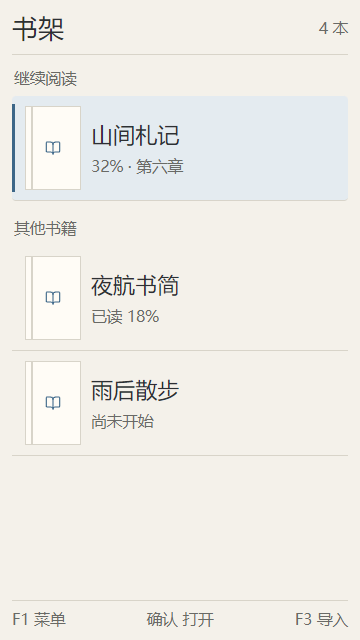

# M1.5 清爽纸感主题与 UI 设计基线

日期：2026-10-18（Asia/Shanghai）。状态：用户要求依据当前问答和样稿编写实现计划，在新对话完成 M1.5；[实现计划](../plans/2026-10-18-m1-5-theme-ui.md) 已整理，尚未实施产品代码。用户指出按键说明页有多处未对齐，明确留到具体实施时优化，本轮保留样稿。

## 1. 目标与设备约束

面向 SH-02L 建立可供 M2、M3 和后续 EPUB 共用的主题与界面规则。保持 TXT 阅读、导入、目录、书签、定位与恢复可用；新增外观能力及用户明确提出的帮助键行为。

以实际设备优先：540×960、已测密度 240 dpi，约 360×640 dp，既有测试环境系统字号倍率为 1.3。正式布局读取当前窗口、密度和字号，不能将样稿尺寸硬编码进产品。所有必要操作可用实体键完成，焦点与实际确认对象一致；采用原生 Views/Canvas，无常驻动画或额外 WebView 运行时。

## 2. 已确认的问答结论

| 项目 | 用户决定 |
| --- | --- |
| 总体气质 | 清爽纸感：米白、暖灰、墨色，少量蓝色强调 |
| 首页重点 | 突出继续阅读及进度，下方排列其他书籍，管理操作在菜单中 |
| 书架样式 | 设置可选纯文字、小书标、独立封面；默认小书标 |
| 封面列表 | 单列，左侧封面、右侧书名与进度，上下键选书 |
| 无封面时 | 使用统一默认封面；切换书架样式保留已导入封面 |
| 封面入口 | 书架选中一本书 → F1 菜单 → 设置/更换封面 |
| 封面来源 | 一个图片文件对应一个封面，可复制导入或移动导入，与图书导入操作同质化 |
| 封面适配 | 居中裁剪铺满，并选择适合设备的裁剪比例 |
| 默认配色 | 已展示的暖米白、墨灰、雾蓝方案 |
| 主题作用域 | 界面主题与正文配色独立，正文保留 5 键循环切换 |
| 浅色/深色方向 | 浅色柔白纸色，深色暖炭灰与柔和米白文字 |
| 选中状态 | 浅灰蓝底、蓝色侧标、墨灰文字；深色主题保持对应的清晰对比 |
| 信息密度 | 舒适均衡，所有设计以 SH-02L 特点为主 |
| 正文软键提示 | 底部常显一行精简的当前可执行操作 |
| 设置结构 | 按类别分层，F2 返回并恢复原焦点 |
| 外观应用 | 调整后立即生效并自动保存，F2 直接返回 |
| 帮助 | 按键分布线稿与短说明；0 打开/关闭，恢复原页面和位置，F2/F4 仍可返回 |

表内结论来自用户逐项问答；下文的尺寸、浅/深色具体色值与模块边界作为实现计划的具体起点，仍需真机可读性验证，不将样稿检查等同产品验收。

## 3. 配色与作用范围

暖色列沿用已确认的配色板；浅色与深色是按用户选定方向拟定的具体值。

| 角色 | 柔白 | 米白纸色 | 暖炭灰 |
| --- | --- | --- | --- |
| 背景 | `#FAFAF7` | `#F4F1EA` | `#252421` |
| 面板 | `#FFFEFA` | `#FFFCF6` | `#302E29` |
| 正文/主文字 | `#2D3033` | `#2D3033` | `#EAE6DD` |
| 次要文字 | `#696A66` | `#696A66` | `#B7B1A6` |
| 强调/侧标 | `#3C6688` | `#3C6688` | `#93B4CE` |
| 选中底色 | `#E4EBF0` | `#E4EBF0` | `#35414A` |
| 分隔线 | `#DCDED8` | `#D8D4C9` | `#4A4740` |

界面主题用于书架、文件浏览、菜单、设置、帮助、诊断和状态页。阅读页的正文、书名栏、信息栏及底部提示一起使用阅读配色，避免夜间正文周围出现亮色条；其覆盖菜单仍使用界面主题。5 键只修改阅读配色，不修改界面主题。首次安装两者均为米白纸色；升级将原 M1 的 theme 值迁移为两份初值，保留字号、亮度、信息栏和所有阅读数据。

不增加完整颜色编辑器。所有主题复用同样的颜色角色、间距和焦点规则；文字颜色对其真实背景进行对比检查。外观设置不作为正文定位数据。

## 4. 页面与几何规则

使用系统字体和 dp/sp；适配系统字号，标题建议 20 sp、列表主文字 17 sp、次要信息与软键 12 sp。这些数值须经真机确认，不以缩小到难读的文字来容纳更多条目。

- 横向正文/列表外边距起点 12 dp，纵向边距 10 dp，轻微圆角 4 dp。
- 普通操作行最小 52 dp，书籍行按两行文字与实际字号增高。主书名最多两行，超出省略；完整名称可在图书操作菜单标题中查看。
- 选中侧标宽 3 dp，各条目预留相同位置，焦点变化不使文字横向跳动。只有当前可执行条目获得选中状态。
- 封面框初稿为 56×84 dp，宽高比 2∶3。3∶4 只作为样稿比较项，尚未决定增加运行时比例设置。
- 继续阅读区紧凑但明确，展示书名与已有进度；只有确实存在章节时显示章节。没有继续阅读记录则省略该区；空书架直接提供可确认的导入项。
- 继续阅读图书在首页只出现一次，下方显示其他书籍。F3 导入保留；书架样式变化不改变正在选中的书籍 ID。
- 纯文字/小书标/封面都保持单列导航。小书标为轻量线条图标；统一默认封面由简单矢量图形组成，无捆绑大型位图素材。
- 正文无翻页动画，菜单覆盖层不改变底层阅读区域。信息栏 8 键显隐仍保留；底部精简软键提示常显。

设置根页先提供“界面外观”“正文阅读”“按键说明”。界面外观包含界面主题、书架样式；正文阅读保留阅读配色、字号、窗口亮度与信息栏。所有设置立即应用并保存；返回每一层恢复原条目及滚动锚点。不添加尚未实现的 M2 入口。

## 5. 封面文件与裁剪

一个导入图片文件绑定当前明确选中的书籍 ID。接受静态 JPEG、PNG、WebP，检查真实可解码内容；统一方向后居中裁剪到封面框比例，缩略图采用相同规则。保留完整原图，切换书架模式及重生成缩略图都不损失原图。

默认 2∶3 兼顾竖版识别与书名空间；通过首版样稿与 3∶4 比较后确定。居中裁剪可能裁去宽图边缘文字，书架右侧始终保留独立书名。M1.5 不引入手动裁剪编辑器、自动识别书名或封面网格。

图片只在后台按目标尺寸采样解码，单次工作位图预算 4 MiB；列表只持有可见及少量相邻缩略图，禁止为全部书籍解码封面。原图输入上限初稿为 32 MiB，未知来源按实际已复制字节执行同样限制。原图、已确认元信息和派生缩略图分开，切换书架样式不删除原图。

新封面写入临时目录、校验、原子发布并提交关联记录后才替换旧封面。失败/取消保留旧封面。重新打开时缺失或损坏的封面回退统一默认封面，正文仍可阅读；派生缩略图可从完整原图重建。

## 6. 导入方式和阶段依赖

为满足封面与图书导入同质化，实现计划把共用文件来源、复制/移动选择和安全提交流程放在 M1.5，让 TXT 与封面同时接入。该依赖在计划中显式列出；M2 的书架数据分页、完整存储管理、可回收正文缓存及低存储进度重试仍保留，当前均未实现。

流程：明确来源和目标 → 选择复制/移动 → 检查空间并流式导入 → 验证完整性与可用性 → 持久提交 → 移动模式尝试删除未变化且有删除授权的来源。只读来源不提供可执行的移动选项；运行中删除失败则显示“导入完成，原文件未删除”，不冒称移动成功。

内存卡与系统文档来源沿用已有选择入口。不能仅因可读取就判定可删除；需保留 File/URI 身份、返回授权与删除能力。重复导入也必须验证私有副本有效，不能盲删来源。跨存储采用提交成功后删除的语义，失败或取消不提前删除来源。

这次接入所需的导入空间预算、过程检查和临时文件清理必须实现；应急空间与进度失败保留/重试按已确认 M2 方案实现，不能以导入成功代替低存储专项验收。移动后的私有原文/封面属于应用用户数据，界面应说明卸载/清除数据的后果，并提供可按键操作的原文件导出路径；导出沿用同一文件选择风格。

## 7. 按键帮助

按实际物理位置绘制正视按键线稿，应用中的按键映射为唯一功能依据：F1 菜单键、F2 相机键、F3 邮件键、F4 网络键；不能将底部 I/II/III 当成 F1—F3。数字、方向、确认、星号与井号标注阅读动作，拨号/清除/挂断和无已知映射的快捷键保留中性系统标记。

0 作为非输入上下文的开关：打开帮助时记录来源页面、菜单层和焦点，关闭时恢复。按键图没有“确认退出”的必经项；抬起与长按不重复开关，同次按键不能穿透到下层翻页。F2/F4 只先关闭帮助。M2 输入框中的 0 继续输入数字。

帮助作为覆盖层呈现，避免销毁/重建底层正文布局；导入期间打开帮助不等于取消导入。图形按主题着色，文字按系统字号适配，禁止为塞入固定图而用不可读的小字。

2026-10-18 最新反馈：用户发现样稿按键说明页多处未对齐，要求先记录、实施时修正。实施验收须核对方向盘与数字中列同一中心轴、两侧功能键成行对称、数字键及罗马键列边缘一致、数字与说明文字基线一致；用统一布局网格与字体度量，不能直接复刻当前截图的错位。当前样稿未作修改。

## 8. 实现边界

在现有三模块内增加必要的集中职责，不为样式引入新运行时依赖：

- 主题与样式：角色化 Palette、界面/阅读两份选择、统一列表/标题/软键组件。
- 页面：继续由同一导航状态驱动视觉与确认对象，设置分类、菜单与帮助覆盖层共用焦点恢复规则。
- 封面存储：按书籍 ID 管理完整原图、关联记录与有界缩略图缓存，提供原子替换和故障回退。
- 共用导入：保留来源能力、空间预算、取消、校验、提交与可选删除，TXT 解码与图片解码各用专用处理器。

外观状态的小文件用原子写入，读取损坏时仅回退外观默认值；不能清空书架或数据库。数据库确需变化时显式迁移，不通过失败后重建清库处理。

## 9. 验证和交付

1. M1 设置与真实书籍升级保留，界面/阅读配色独立，5 键不误改界面，外观立即保存。
2. 三种书架样式切换后原书籍/焦点有效；封面缺失、损坏、长书名和空书架可操作。
3. 复制/移动、未知来源大小、取消、权限拒绝、删除不支持/失败、重复导入和来源变化不会误删来源或损坏私有副本。
4. 封面方向、中心裁剪、超大图片采样及滚动缩略图上限，包含多本书和快速切换场景。
5. 0 开/关、同次抬起、长按、帮助中 F2/F4、菜单恢复和阅读锚点；保留已有按键周期测试。
6. SH-02L 实际字体倍率下所有主题和模式无裁切、焦点清楚、软键可读；字号/信息栏变化仍保持正文锚点。
7. 原有 TXT 导入、分页连续性、目录、书签与最后提交进度恢复回归通过。

用户已要求将本设计和核心样稿整理为实现计划，并在新对话实施。后续发布递增独立版本，保留 `v0.2.0-m1` 原包及证据。网页样稿用于设计检查，不作为 Android 真机验收证据。

## 10. 首版核心样稿

以下为网页样稿的逻辑尺寸截图，并非 SH-02L 真机截图；按 360×640 dp 与字号倍率 1.3 表达设备约束。可交互样稿在当前对话中展示，允许比较 2∶3 与 3∶4，并试放本地图片查看居中裁剪；这不代表已导入或移动任何设备文件。

| 默认小书标 | 单列独立封面（2∶3） |
| --- | --- |
|  |  |

其余截图：[正文](../../images/m1-5-design/reader.png)、[分层设置](../../images/m1-5-design/settings.png)、[按键图](../../images/m1-5-design/help.png)。

首版网页自查覆盖 736/320 px 两种承载宽度：六类页面无横向溢出或正文侵入底部提示，两种封面比例、图片填充、界面/阅读配色独立、帮助关闭恢复菜单焦点均通过。浅/暖/深色的正文、辅助文字及选中态文字对比已检查。这些检查仅针对样稿；Android 验证仍按第 9 节执行。
